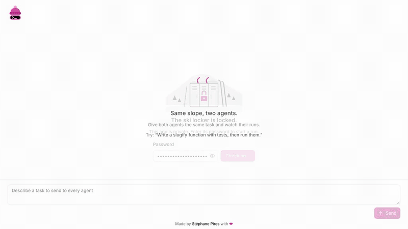
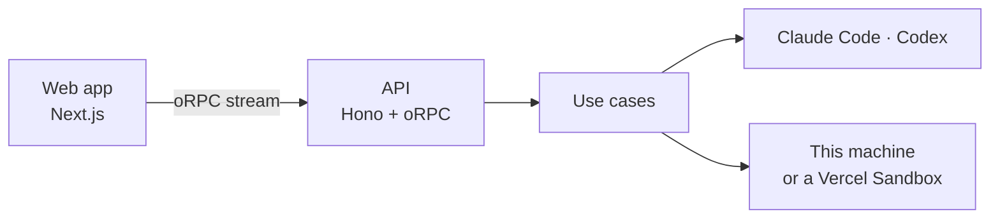

# Coding Agent Comparator

Send one task to **Claude Code** and **Codex**, watch both runs live side by side, and compare what each did.



**[Live app](https://coding-agent-comparator.vercel.app)** · **[API reference](https://coding-agent-comparator-server.vercel.app/docs)** · **[Architecture](docs/infrastructure.md)**

## Try it

The live app runs both agents in Vercel Sandboxes. It is private: ask Stéphane Pires for the password.

## Run it locally

Needs **Node 22.18+** and Git. Nothing else: the agents come with `pnpm install`.

```sh
git clone https://github.com/Stephane-Pires/coding-agent-comparator.git
cd coding-agent-comparator
npx pnpm@10.15.1 install
cp .env.example .env          # paste ANTHROPIC_API_KEY and OPENAI_API_KEY
npx pnpm@10.15.1 dev          # http://localhost:3100
```

No key at hand? Either sign in to Claude Code and Codex on the machine and leave the keys empty, or replay recorded runs with no key at all:

```sh
AGENT_RUNTIME=recorded npx pnpm@10.15.1 dev
```

> [!NOTE]
> Ports 3100 (the page) and 3001 (the API, with its reference at `/docs`) must be free. The install takes about 1.7 GB, mostly the two agents. Tested on macOS; Windows is untested.

## Sample prompts

Each one was run on both agents.

| Prompt                                                                                                                                | Shows                                                    | Ends           |
| ------------------------------------------------------------------------------------------------------------------------------------- | -------------------------------------------------------- | -------------- |
| `Write slugify.mjs exporting a slugify function, with tests in slugify.test.mjs using node:test.`                                     | File edits, two files to open                            | **Finished**   |
| `Search the web for a free exchange-rate API that needs no key, then write rate.mjs that prints the current EUR to USD rate from it.` | A web search with its sources, then code that uses it    | **Finished**   |
| `Create hello.mjs that prints hi.`                                                                                                    | The shortest full run, in under 10 seconds               | **Finished**   |
| `Add unit tests to the existing project.`                                                                                             | The folder is empty, and the review says what is missing | **Incomplete** |
| `hello`                                                                                                                               | No agent starts; the page says how to rephrase           | **Refused**    |

## How it is built



- **Hexagonal.** The rules of a comparison import no agent, framework or cloud. A test fails any import that crosses a boundary ([ADR 0001](docs/adr/0001-hexagonal-architecture.md)).
- **One contract** gives the typed client, the REST API and its OpenAPI document, shown by Scalar at `/docs` ([ADR 0003](docs/adr/0003-zod-neverthrow-orpc.md)).
- **The agents are adapters.** Locally through their SDKs; hosted, by their own command in a sandbox, read line by line by the same translators ([what each agent emits](docs/spike-findings.md)).
- **No database.** Nothing is stored, on the server or in the browser.

## Errors and limits

| Situation                                   | What happens                                                                        |
| ------------------------------------------- | ----------------------------------------------------------------------------------- |
| The task is not a coding task               | Refused before any agent starts, with how to rephrase                               |
| An agent stops without doing the task       | Ends **Incomplete**, with what is missing                                           |
| An agent fails                              | Ends **Did not finish**, in the agent's own words                                   |
| A provider refuses the key or has no credit | "A problem with this app, not your task"; the provider's words go to the server log |
| A provider rate-limits                      | "Busy, try again in a minute"                                                       |
| A hosted run reaches 240 s                  | Stopped, with what to do (a Vercel Function lasts 300 s)                            |
| Over 6 runs at once or 40 an hour, hosted   | Refused, with when to retry; counted from Vercel's own list of sandboxes            |
| A wrong password                            | Answered after one second                                                           |
| Stop is pressed                             | Both runs end **Stopped**; their workspaces are removed                             |

## Checks

| Command                                        | What it proves                                                                             |
| ---------------------------------------------- | ------------------------------------------------------------------------------------------ |
| `pnpm check`                                   | Format, lint, types, architecture boundaries and unit tests. Also run before every commit. |
| `pnpm test:e2e`                                | The real page in a browser, on recorded runs: no key needed                                |
| `pnpm test:e2e:live`                           | The same test on the real agents                                                           |
| `pnpm test:stories`                            | Every component state, in light and dark, with an accessibility audit                      |
| `pnpm eval:task-check`, `pnpm eval:run-review` | The two model checks against labelled sets (32 tasks, 24 runs)                             |

Prefix with `npx pnpm@10.15.1` if pnpm is not installed.

## Shortcuts

| Left out                   | Why                                                                | The fuller version                                                    |
| -------------------------- | ------------------------------------------------------------------ | --------------------------------------------------------------------- |
| History                    | Nothing is stored; a reload clears the page                        | Comparisons saved in the browser, or a database behind a storage port |
| Follow-up messages         | Every task is a fresh comparison in an empty folder                | Resume each agent's session in a kept workspace                       |
| Starting from a repository | Comparisons start from an empty folder                             | Clone a repository into each workspace                                |
| Per-visitor limits         | The cap is shared by everyone, and approximate                     | Counters per visitor in a store such as Redis                         |
| Accounts                   | One shared password                                                | Sign-in, with a budget per user                                       |
| CI                         | The pre-commit hook and Vercel's build of each push are the checks | GitHub Actions running `pnpm check` and the e2e test                  |
| File limits                | Every file a run leaves is sent whole                              | A size and count cap, with a "truncated" state                        |
| Hosted agent versions      | The sandbox uses the agents in Vercel's image, not the lockfile's  | Install the pinned versions in a sandbox snapshot                     |
