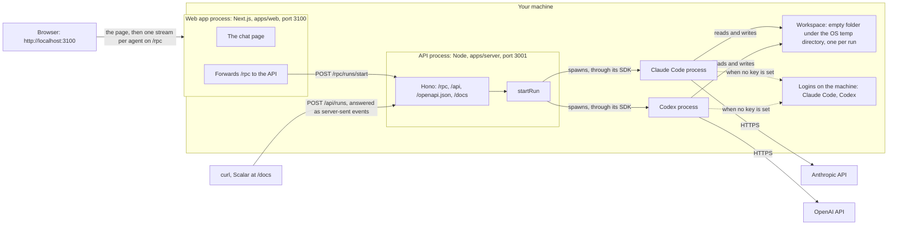

# Infrastructure

What runs, where, and what it needs. This page covers the dev environment. The production environment (Vercel) is
added with the deployment slice.

## Dev environment

One command, `pnpm dev`, starts two processes: the web app and the API. Each run starts one more process, the agent,
in its own folder.

| Part          | What it is                                                                         | Lifetime                      |
| ------------- | ---------------------------------------------------------------------------------- | ----------------------------- |
| Web app       | Next.js serving the chat page. It holds no secret and calls no agent.              | Until you stop `pnpm dev`     |
| API process   | Node running `apps/server/src/main.ts` directly, with no build step                | Until you stop `pnpm dev`     |
| Agent process | The agent's own binary, installed by `pnpm install` with its SDK                   | One run                       |
| Workspace     | A folder `comparator-*` under the OS temp directory, outside the repo              | One run; deleted when it ends |
| State         | None on the server. The page keeps the comparisons in memory until it is reloaded. |                               |

The browser only talks to the web app's origin. The web app forwards `/rpc` to the API, so the API's address is a
server-side setting and no cross-origin rule is needed. A comparison is one stream per agent, opened by the page with
the same task; closing a stream (the Stop button) cancels that run.

### The task check

Before any agent starts, the API asks a model one question: is this a coding task whose result is files? The page
asks first (`/rpc/tasks/check`) and shows one refusal for the comparison; each run asks again by itself, so the check
cannot be skipped by calling the API directly, and finds the verdict already given. A refused task creates no
workspace and starts no agent.

The question is asked one of two ways, to the same small model. With an Anthropic key, the API is called directly:
one request, under a second. With no key, Claude Code asks it, with no tools, on the machine's login: about three
seconds, the time a process takes to start. If the model cannot be reached, the task is accepted: the check is a filter, not a lock. The rule and
the instructions are in the core (`verdictOf`, `TASK_CHECK_INSTRUCTIONS`); `pnpm eval:task-check` measures them on
the labelled tasks of `fixtures/task-check.json`.

### The review of a run

An agent can stop without an error and not have done its task: it asks a question back, or describes what it would
do. So when an agent stops cleanly, the API asks a model one more question: was the task done? It shows the model the
task, what the agent said, the paths of the files it left and how many tools it called, and never which agent it was.
A run that did not do its task ends as **incomplete**, with one sentence saying what is missing.

The question takes the same route as the task check, on the model set by `TASK_CHECK_MODEL`: under a second through
the API, about three through Claude Code. That time is not counted in the run's duration. If the model cannot be reached, the run counts as
finished. `pnpm eval:run-review` measures the instructions on the labelled runs of `fixtures/run-review.json`.

### Recorded runs, and the end-to-end test

With `AGENT_RUNTIME=recorded` the API replays recordings of real runs (`fixtures/recordings.json`) in place of the
agents, their workspaces and the two questions asked to a model. Nothing calls a provider, so it needs no key and no
login, and it gives the same answer whatever the task. Everything above the ports is the real code.

One browser test uses both runtimes:

| Command              | Runs on                        | Guards                                         |
| -------------------- | ------------------------------ | ---------------------------------------------- |
| `pnpm test:e2e`      | the recordings                 | our own code: the use cases, the API, the page |
| `pnpm test:e2e:live` | the real Claude Code and Codex | the agents: a change in what they send         |

To see what a test does, one command: `pnpm test:e2e:film`. It plays the recorded tests at a speed a person can
read and saves a video of each under its name in `e2e-videos/` (ignored by git). Add `E2E_RUNTIME=local` in front
to film the real agents the same way.

A recording cannot show that an agent changed. An agent's binary comes with its SDK, at the version the lockfile
pins, so that can only happen on an upgrade: then run the live test, and make the recordings again with
`pnpm fixtures:record`. Both tests start their own API and a production build of the web app, on ports 3011 and
3110 (`E2E_API_PORT` and `E2E_WEB_PORT` change them), beside a dev server if one is running.

### Routes

| Route                   | What it serves                                                    |
| ----------------------- | ----------------------------------------------------------------- |
| `POST /api/tasks/check` | Says whether a task is a coding task whose result is files        |
| `POST /api/runs`        | Runs one agent on a task; the answer is a stream of events (REST) |
| `POST /rpc/runs/start`  | The same procedure for the typed oRPC client                      |
| `GET /openapi.json`     | The OpenAPI document, generated from the contract                 |
| `GET /docs`             | The API reference (Scalar)                                        |

### Configuration and secrets

Read from the environment, and from a `.env` file at the root of the repository when there is one (see
`.env.example`). The server checks it at startup and stops with the name of any variable that is wrong.

| Variable            | Default                 | Meaning                                                                 |
| ------------------- | ----------------------- | ----------------------------------------------------------------------- |
| `ANTHROPIC_API_KEY` | not set                 | Secret. Without it, Claude Code uses the login on the machine.          |
| `OPENAI_API_KEY`    | not set                 | Secret. Without it, Codex uses the login on the machine.                |
| `CLAUDE_CODE_MODEL` | `haiku`                 | The model Claude Code runs on                                           |
| `CODEX_MODEL`       | `gpt-6-luna`            | The model Codex runs on                                                 |
| `TASK_CHECK_MODEL`  | `claude-haiku-5-5`      | The model that checks a task before a run and reviews it after          |
| `AGENT_RUNTIME`     | `local`                 | `local`: the real agents. `recorded`: recordings of real runs, no key   |
| `PORT`              | `3001`                  | The port of the API                                                     |
| `API_URL`           | `http://localhost:3001` | Read by the web app: where it forwards `/rpc`. Not sent to the browser. |

A key is given to its own agent only. Each agent's process starts without the other provider's variables, and
without any credential variable left in the server's environment: credentials reach an agent through this
configuration and nothing else.

### What an agent may do

An agent runs unattended, so it is never asked for approval.

- **Claude Code:** a fixed list of pre-approved tools (read, write, edit, search, shell, web search, web fetch); its
  working directory is the workspace.
- **Codex:** its own sandbox in `workspace-write` mode, so it writes inside the workspace only; network access and web
  search are on.

On a dev machine the agents are processes of your user. The workspace is where they start, and Codex is confined to
it by its sandbox; Claude Code's shell tool is not. Run tasks you would run yourself.
