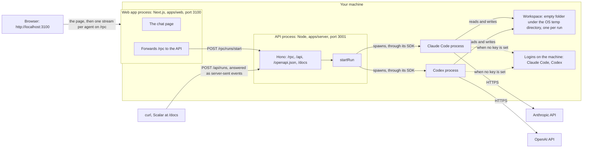
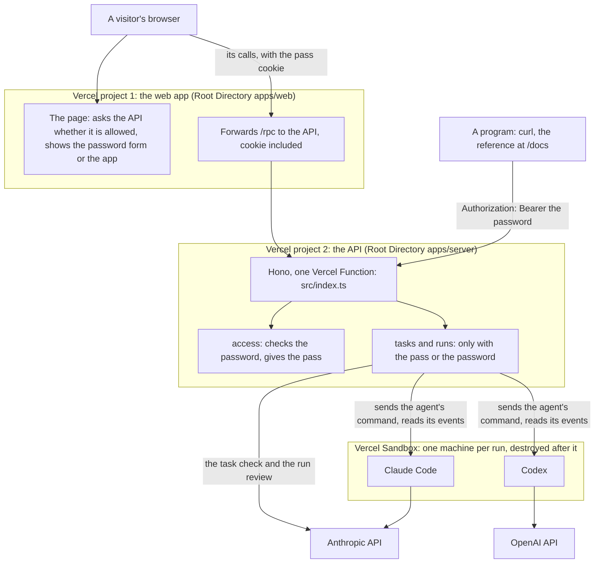

# Infrastructure

What runs, where, and what it needs: first on a dev machine, then [hosted on Vercel](#production-environment). The
code is the same in both; only settings differ.

## Dev environment

One command, `pnpm dev`, starts two processes: the web app and the API. Each run starts one more process, the agent,
in its own folder.

| Part          | What it is                                                                         | Lifetime                      |
| ------------- | ---------------------------------------------------------------------------------- | ----------------------------- |
| Web app       | Next.js serving the chat page. It holds no secret and calls no agent.              | Until you stop `pnpm dev`     |
| API process   | Node running `apps/server/src/main.ts` directly, with no build step                | Until you stop `pnpm dev`     |
| Agent process | The agent's own binary, installed by `pnpm install` with its SDK                   | One run                       |
| Workspace     | A folder `comparator-*` under the OS temp directory, outside the repo              | One run; deleted when it ends |
| State         | None on the server. The page keeps the comparisons in memory until it is reloaded. |                               |

The browser only talks to the web app's origin. The web app forwards `/rpc` to the API (a rewrite in `next.config.ts`), so
the API's address is a server-side setting and no cross-origin rule is needed. A comparison is one stream per agent, opened by the page with
the same task; closing a stream (the Stop button) cancels that run.

### The task check

Before any agent starts, the API asks a model one question: is this a coding task whose result is files? The page
asks first (`/rpc/tasks/check`) and shows one refusal for the comparison; each run asks again by itself, so the check
cannot be skipped by calling the API directly, and finds the verdict already given. A refused task creates no
workspace and starts no agent.

The question is asked one of two ways, to the same small model. With an Anthropic key, the API is called directly:
one request, under a second. With no key, Claude Code asks it, with no tools, on the machine's login: about three
seconds, the time a process takes to start. If the model cannot be reached, the task is accepted: the check is a filter, not a lock. The rule and
the instructions are in the core (`verdictOf`, `TASK_CHECK_INSTRUCTIONS`); `pnpm eval:task-check` measures them on
the labelled tasks of `fixtures/task-check.json`.

### The review of a run

An agent can stop without an error and not have done its task: it asks a question back, or describes what it would
do. So when an agent stops cleanly, the API asks a model one more question: was the task done? It shows the model the
task, what the agent said, the paths of the files it left and how many tools it called, and never which agent it was.
A run that did not do its task ends as **incomplete**, with one sentence saying what is missing.

The question takes the same route as the task check, on the model set by `TASK_CHECK_MODEL`: under a second through
the API, about three through Claude Code. That time is not counted in the run's duration. If the model cannot be reached, the run counts as
finished. `pnpm eval:run-review` measures the instructions on the labelled runs of `fixtures/run-review.json`.

### The agents in a sandbox

With `AGENT_RUNTIME=sandbox` each agent runs in a Vercel Sandbox of its own: a Linux machine made for the run and
destroyed after it. It is the only way to run an agent when the API is hosted, where there is no machine of ours,
and it can be used from a dev machine too.

The API never runs an agent itself there. For one run it:

1. asks Vercel for a sandbox (about 0.3 seconds);
2. sends it the agent's own command, `claude --print … --output-format stream-json` or `codex exec --json …`, with
   that agent's API key and nothing else of ours;
3. reads what the agent prints, one JSON event per line, as it is printed, and gives each line to the same
   translator as on a dev machine;
4. asks the sandbox for the files of the folder after each tool call that ended, and at the end;
5. stops the sandbox, whether the run finished, failed, was stopped by the user or reached its limit.

Three things differ from a run on a dev machine:

- **The agents are those of Vercel's image**, not the versions our lockfile pins. Nothing is installed, which is
  why an agent's first event comes about 1.6 seconds after the sandbox is asked for.
- **Codex's own inner sandbox is turned off.** It cannot start inside a Vercel Sandbox, and Codex then refuses
  every command. The Vercel Sandbox is the isolation.
- **A run has a limit**, 240 seconds by default (`SANDBOX_RUN_LIMIT_SECONDS`): a hosted API cannot hold a request
  for ever. A run that reaches it fails with a sentence saying so.

Both API keys are required: a sandbox has no login. Outside Vercel a sandbox token is needed too, in
`VERCEL_OIDC_TOKEN`; `vercel env pull` writes one that lasts 12 hours.

### Recorded runs, and the end-to-end test

With `AGENT_RUNTIME=recorded` the API replays recordings of real runs (`fixtures/recordings.json`) in place of the
agents, their workspaces and the two questions asked to a model. Nothing calls a provider, so it needs no key and no
login, and it gives the same answer whatever the task. Everything above the ports is the real code.

One browser test uses both runtimes:

| Command                 | Runs on                            | Guards                                            |
| ----------------------- | ---------------------------------- | ------------------------------------------------- |
| `pnpm test:e2e`         | the recordings                     | our own code: the use cases, the API, the page    |
| `pnpm test:e2e:live`    | the real Claude Code and Codex     | the agents: a change in what they send            |
| `pnpm test:e2e:sandbox` | the same, each in a Vercel Sandbox | the hosted path, and the agents of Vercel's image |

To see what a test does, one command: `pnpm test:e2e:film`. It plays the recorded tests at a speed a person can
read and saves a video of each under its name in `e2e-videos/` (ignored by git). Add `E2E_RUNTIME=local` in front
to film the real agents the same way.

A recording cannot show that an agent changed. An agent's binary comes with its SDK, at the version the lockfile
pins, so that can only happen on an upgrade: then run the live test, and make the recordings again with
`pnpm fixtures:record`. Both tests start their own API and a production build of the web app, on ports 3011 and
3110 (`E2E_API_PORT` and `E2E_WEB_PORT` change them), beside a dev server if one is running.

### Routes

| Route                   | What it serves                                                    |
| ----------------------- | ----------------------------------------------------------------- |
| `POST /api/tasks/check` | Says whether a task is a coding task whose result is files        |
| `GET /api/access`       | Says whether the caller may use the API                           |
| `POST /api/access`      | Takes the password; a right one sets the cookie that gives access |
| `POST /api/runs`        | Runs one agent on a task; the answer is a stream of events (REST) |
| `POST /rpc/runs/start`  | The same procedure for the typed oRPC client                      |
| `GET /openapi.json`     | The OpenAPI document, generated from the contract                 |
| `GET /docs`             | The API reference (Scalar)                                        |

### Configuration and secrets

Read from the environment, and from a `.env` file at the root of the repository when there is one (see
`.env.example`). The server checks it at startup and stops with the name of any variable that is wrong.

| Variable                    | Default                 | Meaning                                                                                              |
| --------------------------- | ----------------------- | ---------------------------------------------------------------------------------------------------- |
| `ANTHROPIC_API_KEY`         | not set                 | Secret. Without it, Claude Code uses the login on the machine.                                       |
| `OPENAI_API_KEY`            | not set                 | Secret. Without it, Codex uses the login on the machine.                                             |
| `CLAUDE_CODE_MODEL`         | `haiku`                 | The model Claude Code runs on                                                                        |
| `CODEX_MODEL`               | `gpt-6-luna`            | The model Codex runs on                                                                              |
| `TASK_CHECK_MODEL`          | `claude-haiku-5-5`      | The model that checks a task before a run and reviews it after                                       |
| `AGENT_RUNTIME`             | `local`                 | `local`, `sandbox` (the default on Vercel) or `recorded`                                             |
| `SANDBOX_RUN_LIMIT_SECONDS` | `240`                   | In a sandbox, the longest a run may take                                                             |
| `PORT`                      | `3001`                  | The port of the API                                                                                  |
| `API_URL`                   | `http://localhost:3001` | Read by the web app: where it forwards `/rpc`. Not sent to the browser.                              |
| `DEMO_PASSWORD`             | not set                 | Secret, 8 characters or more. The one password of the app, checked by the API. Required when hosted. |

A key is given to its own agent only. Each agent's process starts without the other provider's variables, and
without any credential variable left in the server's environment: credentials reach an agent through this
configuration and nothing else.

### What an agent may do

An agent runs unattended, so it is never asked for approval.

- **Claude Code:** a fixed list of pre-approved tools (read, write, edit, search, shell, web search, web fetch); its
  working directory is the workspace.
- **Codex:** its own sandbox in `workspace-write` mode, so it writes inside the workspace only; network access and web
  search are on.

On a dev machine the agents are processes of your user. The workspace is where they start, and Codex is confined to
it by its sandbox; Claude Code's shell tool is not. Run tasks you would run yourself.

## Production environment

Two Vercel projects, built from this one repository. A push to `main` deploys both.

### The password

One password, `DEMO_PASSWORD`, checked in one place: the API (`apps/server/src/access.ts`). The API is what spends the
API keys, and it has a public address of its own, so the lock is there and nowhere else. The web app holds no secret.

| Step             | What happens                                                                                |
| ---------------- | ------------------------------------------------------------------------------------------- |
| The page loads   | It asks `access.get`. Until the answer comes it shows its header only, never the app.       |
| Not allowed      | It shows the password form.                                                                 |
| The form is sent | `access.enter` checks the password. A right one sets a cookie, the pass.                    |
| Every later call | The browser sends the pass by itself; `tasks.check` and `runs.start` answer 401 without it. |

- The pass is a cookie no script of the page can read (`HttpOnly`), that another site cannot make the browser send
  (`SameSite=Lax`), sent over HTTPS only, and kept for a week. It holds a digest, not the password; changing
  `DEMO_PASSWORD` ends every pass.
- The cookie belongs to the web app's address: the browser only ever talks to that address, and the forwarding
  carries the cookie to the API and its answer back.
- A program sends the password with each call, as `Authorization: Bearer <password>`. The reference at `/docs` has a
  field for it. `/docs` and `/openapi.json` are open: they spend nothing.
- **A hosted API without `DEMO_PASSWORD` does not start.** Nothing is left open by forgetting the setting.
- On a dev machine no password is set and everyone is allowed. The end-to-end tests set one, so they run the app as
  it is hosted.
- Known limits: the page itself and its scripts are served to anyone; they hold no data, and no call works without
  the password. Nothing slows down someone who tries passwords one after another, so choose a long one.

### What differs from a dev machine

|                      | Dev machine                                       | Vercel                                            |
| -------------------- | ------------------------------------------------- | ------------------------------------------------- |
| Entry of the API     | `src/main.ts`: serves on a port                   | `src/index.ts`: hands the same Hono app to Vercel |
| Where the agents run | Processes on the machine (`AGENT_RUNTIME=local`)  | Sandboxes, the default there and the only choice  |
| The two questions    | The Anthropic API with a key, Claude Code without | The Anthropic API                                 |
| Credentials          | Keys or logins                                    | Keys only                                         |
| Password             | None                                              | Required                                          |
| Longest run          | No limit                                          | 240 seconds, under the 300 a function may last    |

The hosted entry must never load an agent's SDK: a function holds 250 MB at most, and the agents weigh 700 MB.
`tooling/hosted-entry.test.ts` follows every import from `src/index.ts` and fails if one leads to an SDK.

### Setting it up

Done once, in Vercel's dashboard.

1. Create two projects from the GitHub repository:

   | Project                       | Root Directory | Framework |
   | ----------------------------- | -------------- | --------- |
   | `coding-agent-comparator-api` | `apps/server`  | Hono      |
   | `coding-agent-comparator`     | `apps/web`     | Next.js   |

2. Set the environment variables, for Production:

   | Project | Variable            | Value                                                                           |
   | ------- | ------------------- | ------------------------------------------------------------------------------- |
   | API     | `ANTHROPIC_API_KEY` | The Anthropic key                                                               |
   | API     | `OPENAI_API_KEY`    | The OpenAI key                                                                  |
   | API     | `DEMO_PASSWORD`     | The password you give to visitors, 8 characters or more                         |
   | Web     | `API_URL`           | The address of the API project, `https://…vercel.app`, with no slash at the end |

   The sandbox token is not in this list: Vercel gives it to the API by itself. `API_URL` is read when the web app
   is built: after changing it, deploy the web project again.

   Vercel's build can be run on a dev machine, to see a failure without deploying: in a plain clone (not a git
   worktree), from `apps/server`, link the folder with `vercel link`, set `"framework": "hono"` in
   `.vercel/project.json`, then `pnpm dlx vercel@latest build`.

3. Deploy the API first, then the web app. From then on, a push to `main` deploys both.
