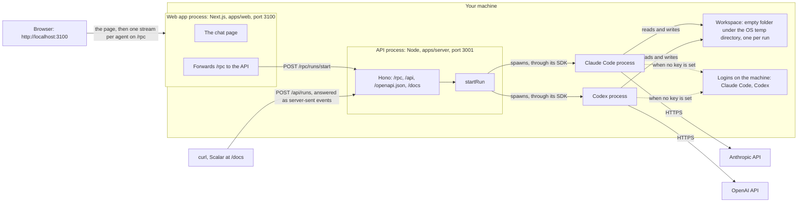
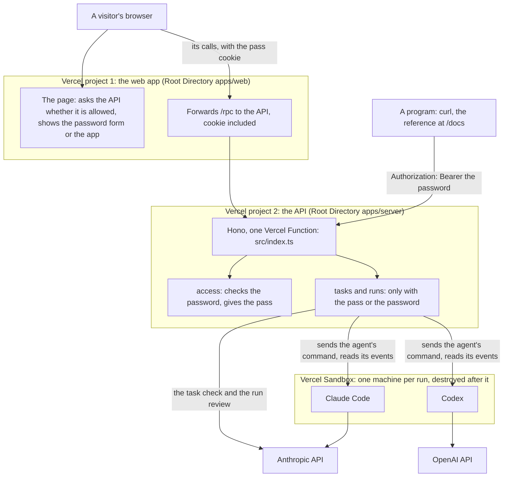

# Infrastructure

What runs where, on a dev machine and [on Vercel](#production-environment). Same code; only settings differ.

## Dev environment

`pnpm dev` starts the web app and the API. Each run adds one agent process, in its own folder.

| Part      | What it is                                               | Lives                  |
| --------- | -------------------------------------------------------- | ---------------------- |
| Web app   | Next.js; forwards `/rpc` to the API. Holds no secret.    | Until `pnpm dev` stops |
| API       | Hono on Node (`apps/server/src/main.ts`), no build step  | Until `pnpm dev` stops |
| Agent     | Its binary, installed with its SDK by `pnpm install`     | One run                |
| Workspace | An empty folder under the OS temp directory              | One run, then deleted  |
| State     | None on the server; the page keeps comparisons in memory | Until the page reloads |

### Where the agents run

`AGENT_RUNTIME` picks it:

| Value             | Agents                                               | Needs                                             |
| ----------------- | ---------------------------------------------------- | ------------------------------------------------- |
| `local` (default) | Processes on the machine, through their SDKs         | Keys, or the machine's logins                     |
| `sandbox`         | One Vercel Sandbox per run, by their own command     | Keys, and `VERCEL_OIDC_TOKEN` (`vercel env pull`) |
| `recorded`        | Replays of real runs from `fixtures/recordings.json` | Nothing                                           |

In a sandbox, the agents are the versions in Vercel's image, and Codex's inner sandbox is off: the Vercel Sandbox is
the isolation.

### The two model checks

A small model checks the task before a run and the result after it. It is the Anthropic API with a key, Claude Code
without. If the model cannot be reached, the task is accepted and the run counts as finished.

### Secrets

Read from the environment and `.env`; every variable is in `.env.example`. Each agent gets its own key and no other
credential.

## Production environment

Two Vercel projects from this repository. A push to `main` deploys both.

| Part      | What it is                                                                                                                                         | Lives                                          |
| --------- | -------------------------------------------------------------------------------------------------------------------------------------------------- | ---------------------------------------------- |
| Web app   | Vercel project `coding-agent-comparator`, Next.js, at `alpic.stephanepires.com`; forwards `/rpc` to the API with the pass cookie. Holds no secret. | Until the next deploy                          |
| API       | Vercel project `coding-agent-comparator-server`: Hono in one Vercel Function (`apps/server/src/index.ts`)                                          | One request, 300 s at most                     |
| Sandbox   | A Linux machine for one agent's run, created with `persistent: false`                                                                              | One run, 240 s at most, then stopped           |
| Agent     | The version in Vercel's image, started by its own command                                                                                          | One run                                        |
| Workspace | A folder inside the sandbox                                                                                                                        | Goes with the sandbox                          |
| State     | None on the server; the browser keeps the pass cookie and the comparisons in memory                                                                | A week for the pass; until reload for the rest |

|             | Dev machine    | Vercel                                   |
| ----------- | -------------- | ---------------------------------------- |
| Credentials | Keys or logins | Keys only                                |
| Password    | None           | `DEMO_PASSWORD`, required to start       |
| Longest run | No limit       | 240 s, under a function's 300 s          |
| Use         | No limit       | 6 runs at once, 40 an hour, for everyone |

### The password

Checked only by the API (`apps/server/src/access.ts`), which spends the keys. A right password sets a pass cookie
(`HttpOnly`, `SameSite=Lax`, one week); programs send `Authorization: Bearer <password>`. A wrong one is answered
after 1 s.

### Limits on use

No counter is stored: before each run, the API counts the project's sandboxes in Vercel's own list
(`apps/server/src/runtimes/hosted.ts`). Approximate, and it lets the run go if the list cannot be read. The real cap
on the bill is a spending limit on each key.

### Setting it up

1. Create two projects from the GitHub repository:

   | Project                          | Root Directory | Framework | Variables                                              |
   | -------------------------------- | -------------- | --------- | ------------------------------------------------------ |
   | `coding-agent-comparator-server` | `apps/server`  | Hono      | `ANTHROPIC_API_KEY`, `OPENAI_API_KEY`, `DEMO_PASSWORD` |
   | `coding-agent-comparator`        | `apps/web`     | Next.js   | `API_URL`: the API's address, no trailing slash        |

2. Deploy the API, then the web app. `API_URL` is read at build: redeploy the web app after changing it.

3. Give the web app its address: `vercel domains add alpic.stephanepires.com coding-agent-comparator`, then the
   `CNAME` that `vercel domains verify alpic.stephanepires.com` asks for. The domain's DNS is in Route 53, kept by
   Terraform outside this repository. The cookie and the forwarding need no change: the browser only talks to the
   web app's address.
