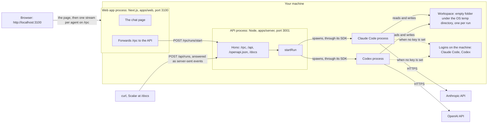
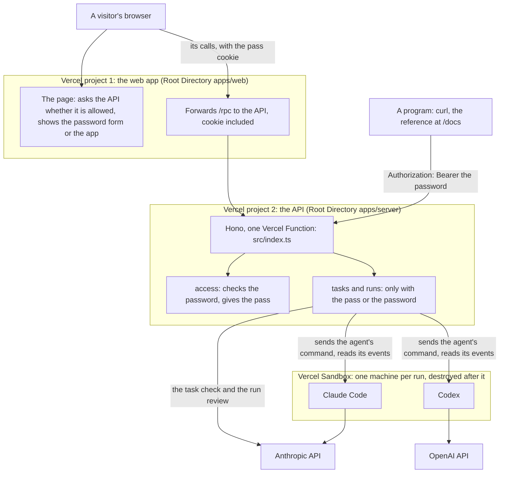

# Infrastructure

What runs where, on a dev machine and [on Vercel](#production-environment). Same code; only settings differ.

## Dev environment

`pnpm dev` starts the web app and the API. Each run adds one agent process, in its own folder.

| Part      | What it is                                                   | Lives                  |
| --------- | ------------------------------------------------------------ | ---------------------- |
| Web app   | Next.js, the chat page. No secret, calls no agent.           | Until `pnpm dev` stops |
| API       | Node running `apps/server/src/main.ts`, no build step        | Until `pnpm dev` stops |
| Agent     | The agent's binary, installed with its SDK by `pnpm install` | One run                |
| Workspace | `comparator-*` under the OS temp directory                   | One run, then deleted  |
| State     | None on the server; the page keeps comparisons in memory     | Until the page reloads |

- The browser only talks to the web app, which forwards `/rpc` to the API (`next.config.ts`). No cross-origin rule.
- A comparison is one stream per agent. Closing a stream (Stop) cancels that run.

### The task check

Before any agent starts, a small model answers: is this a coding task whose result is files?

- The page asks first (`/rpc/tasks/check`); each run asks again, so calling the API directly cannot skip it.
- A refused task starts no workspace and no agent.
- With an Anthropic key: one API call, under 1 s. Without: Claude Code on the machine's login, about 3 s.
- If the model is unreachable, the task is accepted: a filter, not a lock.
- Rule and instructions: `verdictOf`, `TASK_CHECK_INSTRUCTIONS`. Measured by `pnpm eval:task-check` on
  `fixtures/task-check.json`.

### The review of a run

An agent can stop cleanly without doing the task (it asks a question back, or describes a plan). So after a clean
stop, the same small model answers: was the task done?

- It sees the task, what the agent said, the files left and the number of tool calls; never which agent it was.
- Not done: the run ends **Incomplete**, with one sentence on what is missing.
- Same route and times as the task check, not counted in the run's duration. Unreachable model: the run is finished.
- Measured by `pnpm eval:run-review` on `fixtures/run-review.json`.

### The agents in a sandbox

`AGENT_RUNTIME=sandbox` runs each agent in its own Vercel Sandbox, a Linux machine made for the run. It is the only
way when hosted, and works from a dev machine too. For one run, the API:

1. creates a sandbox (about 0.3 s);
2. sends the agent's command (`claude --print … --output-format stream-json`, `codex exec --json …`) with that
   agent's key only;
3. reads one JSON event per line, through the same translators as locally;
4. reads the folder's files after each tool call, and at the end;
5. stops the sandbox, however the run ended.

Differences from a local run:

- **The agents are Vercel's image versions**, not the lockfile's. Nothing is installed: first event at about 1.6 s.
- **Codex's inner sandbox is off.** It cannot start there; the Vercel Sandbox is the isolation.
- **A run lasts 240 s at most**, then fails with a sentence saying so.
- **Both keys are required** (no login). Outside Vercel, also `VERCEL_OIDC_TOKEN`: `vercel env pull` writes one
  valid 12 hours.

### Recorded runs and the end-to-end tests

`AGENT_RUNTIME=recorded` replays real runs from `fixtures/recordings.json` instead of the agents, workspaces and
model questions. No key, no login, same answer whatever the task. Everything above the ports is the real code.

| Command                 | Runs on                     | Guards                                      |
| ----------------------- | --------------------------- | ------------------------------------------- |
| `pnpm test:e2e`         | The recordings              | Our code: use cases, API, page              |
| `pnpm test:e2e:live`    | The real agents             | A change in what the agents send            |
| `pnpm test:e2e:sandbox` | The real agents, in Sandbox | The hosted path and Vercel's agent versions |

- `pnpm test:e2e:film` plays the recorded tests at reading speed and saves a video each in `e2e-videos/`. Prefix
  `E2E_RUNTIME=local` to film the real agents.
- After upgrading an agent's SDK: run the live test, then `pnpm fixtures:record`.
- Each test starts its own API and web build on ports 3011 and 3110 (`E2E_API_PORT`, `E2E_WEB_PORT`), beside a dev
  server.

### Routes

| Route                   | Does                                                       |
| ----------------------- | ---------------------------------------------------------- |
| `POST /api/tasks/check` | Says whether a task is a coding task whose result is files |
| `GET /api/access`       | Says whether the caller may use the API                    |
| `POST /api/access`      | Checks the password; a right one sets the pass cookie      |
| `POST /api/runs`        | Runs one agent on a task, as a stream of events (REST)     |
| `POST /rpc/runs/start`  | The same, for the typed oRPC client                        |
| `GET /openapi.json`     | The OpenAPI document, generated from the contract          |
| `GET /docs`             | The API reference (Scalar)                                 |

### Configuration and secrets

- Read from the environment and from `.env` at the repository root. Every variable and default is in `.env.example`.
- The server checks them at startup and stops naming any wrong variable.
- Each agent gets its own key only: no other provider's variable, no other credential of the server.

### What an agent may do

Agents run unattended, never asked for approval.

- **Claude Code:** a fixed list of pre-approved tools (read, write, edit, search, shell, web search, web fetch),
  started in the workspace.
- **Codex:** its sandbox in `workspace-write`, so it writes only in the workspace; network and web search on.

Locally, agents run as your user. Codex is confined to the workspace; Claude Code's shell is not. Run tasks you would
run yourself.

## Production environment

Two Vercel projects from this repository. A push to `main` deploys both.

### The password

One password, `DEMO_PASSWORD`, checked only by the API (`apps/server/src/access.ts`): the API spends the keys and has
its own public address. The web app holds no secret.

| Step             | What happens                                                              |
| ---------------- | ------------------------------------------------------------------------- |
| The page loads   | It asks `access.get`; until the answer, only the header shows             |
| Not allowed      | The password form                                                         |
| Form sent        | `access.enter` checks it; a right one sets the pass cookie                |
| Every later call | The browser sends the pass; `tasks.check` and `runs.start` 401 without it |

- The pass: `HttpOnly`, `SameSite=Lax`, HTTPS only, one week. It holds a digest; changing `DEMO_PASSWORD` ends every
  pass.
- The cookie is on the web app's address; the forwarding carries it to the API.
- Programs send `Authorization: Bearer <password>`; `/docs` has a field for it. `/docs` and `/openapi.json` are open.
- **A hosted API without `DEMO_PASSWORD` does not start.**
- Locally there is no password. The end-to-end tests set one, to run as hosted.
- A wrong password is answered after 1 s. Nothing is counted or stored.
- Known limit: the page and its scripts are public; they hold no data.

### Limits on use

Shared by everyone: **6 runs at once, 40 an hour** (3 comparisons at once, 20 an hour), in
`apps/server/src/runtimes/hosted.ts`.

- No counter: before creating a sandbox, the API reads Vercel's list of the project's sandboxes (about 0.3 s).
- Over a limit, the run does not start and says which limit and when to retry.
- Approximate: two runs at the same instant can both pass. If the list cannot be read, the run goes ahead.
- A provider rate limit ends the run with "busy, try again in a minute"; its words go to the server log.
- The real cap on the bill is a spending limit on each key, set at Anthropic and OpenAI.

### What differs from a dev machine

|                   | Dev machine                                   | Vercel                                            |
| ----------------- | --------------------------------------------- | ------------------------------------------------- |
| API entry         | `src/main.ts`, serves on a port               | `src/index.ts`, hands the same Hono app to Vercel |
| Agents run        | On the machine (`AGENT_RUNTIME=local`)        | In sandboxes, the only choice                     |
| The two questions | Anthropic API with a key, Claude Code without | Anthropic API                                     |
| Credentials       | Keys or logins                                | Keys only                                         |
| Password          | None                                          | Required                                          |
| Longest run       | No limit                                      | 240 s, under a function's 300 s                   |
| Use               | No limit                                      | 6 at once, 40 an hour                             |

Three traps, each already handled:

- **TypeScript entries.** Our packages export `.ts` files. `apps/server/vercel.json` includes their sources in the
  function; without it, the first request fails on `@comparator/contracts/src/index.ts`.
- **`@vercel/sandbox` pinned to 4.0.0.** From 4.1.0 it pulls `@vercel/drives`, which a Vercel Function cannot load
  (`ERR_REQUIRE_ESM`). Test an upgrade with `node --no-experimental-require-module` on the built function.
- **No agent SDK in the function.** A function holds 250 MB; the agents weigh 700 MB.
  `tooling/hosted-entry.test.ts` fails if an import from `src/index.ts` reaches an SDK.

### Setting it up

Once, in Vercel's dashboard.

1. Create two projects from the GitHub repository:

   | Project                          | Root Directory | Framework |
   | -------------------------------- | -------------- | --------- |
   | `coding-agent-comparator-server` | `apps/server`  | Hono      |
   | `coding-agent-comparator`        | `apps/web`     | Next.js   |

2. Set the Production variables:

   | Project | Variable            | Value                                              |
   | ------- | ------------------- | -------------------------------------------------- |
   | API     | `ANTHROPIC_API_KEY` | The Anthropic key                                  |
   | API     | `OPENAI_API_KEY`    | The OpenAI key                                     |
   | API     | `DEMO_PASSWORD`     | 8 characters or more                               |
   | Web     | `API_URL`           | The API's `https://…vercel.app`, no trailing slash |

   Vercel provides the sandbox token itself. `API_URL` is read at build: redeploy the web app after changing it.

3. Deploy the API, then the web app.

To reproduce Vercel's build locally: in a plain clone (not a worktree), from `apps/server`, run `vercel link`, set
`"framework": "hono"` in `.vercel/project.json`, then `pnpm dlx vercel@latest build`.
