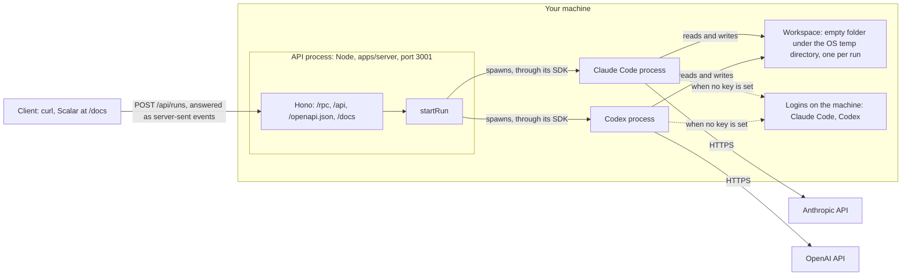

# Infrastructure

What runs, where, and what it needs. This page covers the dev environment. The production environment (Vercel) is
added with the deployment slice.

## Dev environment

One command, `pnpm dev`, starts one process: the API. Each run starts one more process, the agent, in its own folder.

| Part          | What it is                                                            | Lifetime                      |
| ------------- | --------------------------------------------------------------------- | ----------------------------- |
| API process   | Node running `apps/server/src/main.ts` directly, with no build step   | Until you stop `pnpm dev`     |
| Agent process | The agent's own binary, installed by `pnpm install` with its SDK      | One run                       |
| Workspace     | A folder `comparator-*` under the OS temp directory, outside the repo | One run; deleted when it ends |
| State         | None. The server keeps nothing between requests, and has no database. |                               |

### Routes

| Route                  | What it serves                                                    |
| ---------------------- | ----------------------------------------------------------------- |
| `POST /api/runs`       | Runs one agent on a task; the answer is a stream of events (REST) |
| `POST /rpc/runs/start` | The same procedure for the typed oRPC client                      |
| `GET /openapi.json`    | The OpenAPI document, generated from the contract                 |
| `GET /docs`            | The API reference (Scalar)                                        |

### Configuration and secrets

Read from the environment, and from a `.env` file at the root of the repository when there is one (see
`.env.example`). The server checks it at startup and stops with the name of any variable that is wrong.

| Variable            | Default      | Meaning                                                        |
| ------------------- | ------------ | -------------------------------------------------------------- |
| `ANTHROPIC_API_KEY` | not set      | Secret. Without it, Claude Code uses the login on the machine. |
| `OPENAI_API_KEY`    | not set      | Secret. Without it, Codex uses the login on the machine.       |
| `CLAUDE_CODE_MODEL` | `haiku`      | The model Claude Code runs on                                  |
| `CODEX_MODEL`       | `gpt-6-luna` | The model Codex runs on                                        |
| `PORT`              | `3001`       | The port of the API                                            |

A key is given to its own agent only. Each agent's process starts without the other provider's variables, and
without any credential variable left in the server's environment: credentials reach an agent through this
configuration and nothing else.

### What an agent may do

An agent runs unattended, so it is never asked for approval.

- **Claude Code:** a fixed list of pre-approved tools (read, write, edit, search, shell, web search, web fetch); its
  working directory is the workspace.
- **Codex:** its own sandbox in `workspace-write` mode, so it writes inside the workspace only; network access and web
  search are on.

On a dev machine the agents are processes of your user. The workspace is where they start, and Codex is confined to
it by its sandbox; Claude Code's shell tool is not. Run tasks you would run yourself.
